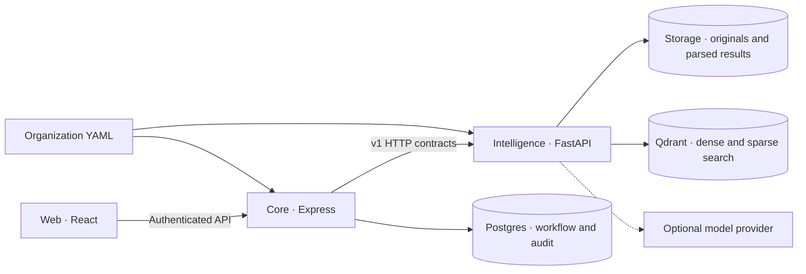

# IntelliDocs

IntelliDocs turns circulars, policies, contracts, and other operational documents into searchable evidence and accountable work. It parses multilingual documents, answers questions with citations to the original passages, and gives each department or role a focused summary. It extracts duties and deadlines into a task feed with owners, review queues, and an audit trail. When a manager confirms that a newer document supersedes, withdraws, or amends an earlier one, affected tasks are flagged so people can review them before acting.

The same application supports different organizations through YAML configuration. The bundled examples cover a legal and finance office in English and Hindi and a water utility in Spanish and French.

## Architecture



Core owns identity, permissions, workflow, and audit. Intelligence owns document processing and evidence. The web app calls Core. See [the upload-to-task flow and tenant boundary](docs/architecture.md).

## Feature-to-code map

| Feature | Start here |
| --- | --- |
| Upload, OCR, page structure, and document type suggestions | [Core upload](services/core/src/upload.ts), [ingestion](services/intelligence/app/ingestion.py), [parsers](services/intelligence/app/parsing/), [classification](services/intelligence/app/classification/) |
| Chunking, indexing, and hybrid search | [Chunking](services/intelligence/app/chunking/), [indexing](services/intelligence/app/indexing.py), [retrieval](services/intelligence/app/retrieval/) |
| Grounded answers, role-aware summaries, and source viewing | [Generation](services/intelligence/app/generation/), [verification](services/intelligence/app/verification/), [summarization](services/intelligence/app/summarization/), [citation panel](apps/web/src/search/citation-panel.tsx) |
| Obligation extraction, review, and task routing | [Extraction](services/intelligence/app/extraction/), [manager review](services/core/src/review/), [routing](services/core/src/routing/), [tasks](services/core/src/tasks/) |
| Amendments, supersession, and stale tasks | [Relation detection](services/intelligence/app/relations/), [relation review and staleness](services/core/src/relations/) |
| Auth, permissions, and audit | [Core auth](services/core/src/auth/), [audit](services/core/src/audit.ts), [oversight UI](apps/web/src/oversight/) |
| Organization setup, API contracts, and evaluation | [Org examples](config/orgs/), [contracts](contracts/), [evaluation runner](eval/run_all.py) |

## Quick start

Install Docker with Compose v2.24.4 or newer and Python 3.11 or newer. Run this from the repository root.

```sh
bash scripts/demo.sh
```

The script creates an isolated Compose project, applies migrations, and loads synthetic pilot documents and accounts for both organizations. Open the printed **Web login** URL and use the printed operator credentials, including the organization slug. Open **Documents** to inspect a pilot document or **Search** to try a citation. The local demo uses fixture model responses and deterministic embeddings.

Use the printed `bash scripts/demo.sh down …` command to remove the pilot containers and volumes. The ignored pilot directory contains the local files and credentials. See [the timing pilot](eval/timing/README.md) for its generated files and [the deployment guide](docs/deploy.md) for a hosted setup.

### Demo credentials policy

Each local demo generates its own credentials. Treat the printed values and `data/demo/*/access.json` as private. Keep logins, bootstrap and signing secrets, provider keys, and `.env` out of Git, screenshots, and shared logs. For a hosted demo, supply passwords via environment settings and seed least-privilege accounts using the [public demo guide](docs/public-demo.md#seed-demo-accounts).

## Screenshots

These placeholders describe the states to capture using synthetic documents and accounts.

- [Search and cited source](screenshots/search.md)
- [Task feed and status actions](screenshots/tasks.md)
- [Audit trail with a before-and-after diff](screenshots/audit.md)
- [Users and roles](screenshots/users.md)
- [Organization configuration](screenshots/organisation.md)

## Limitations

- The [combined evaluation](docs/evaluation.md) exercises OCR and retrieval on small synthetic sets, replays answer drafts, and scores saved extraction, relation, and summary outputs. It provides regression evidence for the pipeline and scorer. Production model accuracy, broad multilingual quality, and performance on representative organizational collections remain unmeasured.
- The CUAD and SROIE subset runs cover English contract spans and receipt fields. The CUAD labels only cover selected clauses. SROIE has no obligation labels. These runs leave owner and deadline accuracy on real documents, cross-lingual quality at scale, and FUNSD performance open.
- Citation checks establish traceability to a source span. The optional claim-support check addresses whether the passage supports the claim. A confirmed relation can flag stale work for review. Legal or policy interpretation still requires a qualified reviewer.
- The timing pilot has fixture-backed API measurements and awaits stopwatch measurements from people. There is no measured manual-to-system speedup.
- The hosted free profiles disable LLM features. Their temporary disks can lose uploaded originals across restarts. See the [deployment guide](docs/deploy.md).

For development checks and the browser integration flow, see [Contributing](CONTRIBUTING.md). The [Core API and permissions](services/core/README.md#api-reference), [Intelligence OpenAPI](contracts/openapi/intelligence.v1.yaml), and [web README](apps/web/README.md) cover component-level details.
